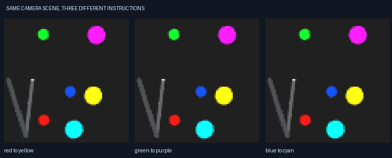

# tabletop vla | articulated-arm imitation baseline

A camera image and a text command drive a learned robot policy in MuJoCo. The same scene can mean “move the red puck to yellow” or “move the green puck to purple”; the arm should carry out whichever task the command specifies.



## What is learned

1. A supervised RGB pixel classifier learns seven chromatic prototypes (six labels and background) from simulator-rendered pixels. A calibrated camera converts the first reliable detections into planar target geometry; those locations are cached because this benchmark's ungrasped objects and pads are static.
2. A linear bag-of-words text head learns the named puck and pad from two training sentence forms. It must recombine known words. It does not understand open language, order-sensitive instructions, or unseen colors.
3. A 48×48 tanh MLP clones expert demonstrations. Its observations are pose-relative camera geometry and the wrist's x/y and grasp bit. It predicts two Cartesian increments and a continuous gripper signal. The environment converts increments to joint position targets through analytic IK; actual arm motion is simulated with position actuators. A proximity latch approximates grasping, not contact physics.

Expert-only inputs include object poses; neither positions nor scene/task IDs are inference inputs. The expert is also the source of behavior-cloning action labels. MuJoCo segmentation labels supervise pixel prototypes during training, never at inference. Training used 420 successful noisy-expert trajectories, 12,650 weighted rows, and one learned checkpoint. The included NPZ contains the features and labels used by the action learner; raw RGB streams can be generated from the simulator but are not bundled. This is not end-to-end joint training of the three components, a foundation model, or an LLM wrapper.

## Frozen closed-loop results

Train never pairs red–yellow, green–purple, or blue–cyan. Held-out scenes combine exactly those three pairings with two held-out templates, sharing known task words but rearranging phrasing. Every fresh scene runs every assigned task. No checkpoint tuning on test. Wrist measurements and the grasp bit are allowed in every policy condition.

| condition | seen pairs, new scenes | unseen pairs and wording, new scenes |
|---|---:|---:|
| privileged-state expert | 72/72 | 72/72 |
| camera + language learned policy | 72/72 | 72/72 |
| another command in the same scene | 0/72 | 0/72 |
| no language, fixed red–yellow default | 0/72 | 24/72 |
| fixed RGB from unrelated training scene | 0/72 | 0/72 |

When shown the wrong command, the policy successfully carries out that **shown** task in all 72 held-out episodes, rather than the task being scored. The no-language control succeeds on exactly the held-out command that matches its default. Fixed-vision failures: 61 timeouts, 6 wrong objects, 5 wrong destinations. These are inference interventions on one frozen model, not separately fitted ablations. The same-scene test is 24 layouts, not 72 independent scenes; a degenerate bootstrap from all-success clusters does not establish a true 100% success probability. This is evidence for grounding under restricted simulation and a fixed camera, not robustness at scale.

Held-out median: 18 modeled action steps (expert also 18). The bulk of policy calls use cached locations, so the median policy-call time, 0.075 ms, does not measure first-frame perception. Median closed-loop simulator plus render time was 2.89 ms/action, measured here on CPU. Simulation time advances by 0.16 s/action. Timing should be treated as hardware-specific and excludes initial setup.

## Reproduce

Python 3.12, Linux headless EGL; pin versions in requirements.txt. EGL requires a working system driver (software Mesa worked here). Use a local environment, no account or hosted compute.

```bash
python -m pip install -r requirements.txt
export MUJOCO_GL=egl OPENBLAS_NUM_THREADS=1 OMP_NUM_THREADS=1
python train.py
python evaluate.py --dev
python evaluate.py
python evaluate.py --summary
python -m unittest -v test_pipeline
python demo.py
```

Skip training to run the included frozen checkpoint. See PLAN.md, the plain NPZ arrays and pre-test checksum file; the evaluation command writes per-episode records.

## Next milestone

Run a separately frozen shift test that moves the designated object/zone mid-episode to quantify failure of the initial location cache. Build a tracking baseline and test motion/noise/occlusion without retuning on the frozen test. After that: physical grasp contacts and richer tasks, a single learned image–instruction fusion encoder, then a controlled offline imitation vs DAgger/RL comparison. None of those are achieved by this checkpoint.
