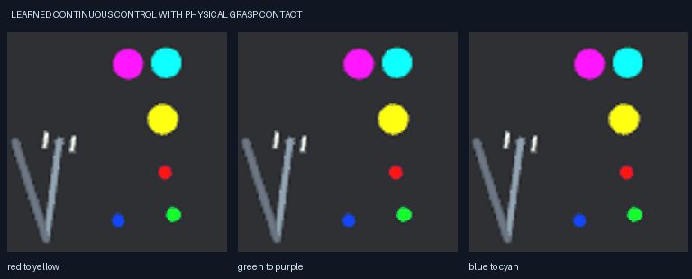

# tabletop vla

a small vision-language-action policy for simulated pick and place. give it a command like “put the red puck on the yellow pad.” it takes rgb, text, and wrist/finger readings, then predicts delta xyz and how far to close the gripper. the puck lifts through friction between the fingers, not a scripted attachment.



## results

trained by imitation on 360 scripted demonstrations (24,600 control samples). the same checkpoint went 216/216 across nominal, reduced-friction, and displaced-start trials. those trials share 24 held-out layouts and test held-out color pairings and phrasings built from known words. the two stress conditions also corrupt the camera image.

with a swapped command, the robot followed the shown instruction in 72/72 trials and the original instruction in 0/72. with a blank camera image, it completed 0/72. the checkpoint uses a calibrated camera, fixed color vocabulary, and a static scene. this is a simulation benchmark, not rl, open-ended language understanding, or a hardware result.

## run it

python 3.12 on linux with a working headless egl graphics driver. the included checkpoint, demonstrations, and gif are generated in simulation. no account, outside dataset, or gpu is required.

```bash
python3.12 -m venv .venv
source .venv/bin/activate
python -m pip install -r requirements.txt
export MUJOCO_GL=egl OPENBLAS_NUM_THREADS=1 OMP_NUM_THREADS=1
export PYTHONPATH="$PWD:$PWD/contact:$PWD/contact_policy"
sha256sum -c contact_policy/frozen.sha256
python -m unittest -v contact_policy/test_contact_policy.py
python contact_policy/replay.py --puck red --pad yellow
```

the replay uses a separate scene and writes `preview/grasp.gif`. to reproduce the 576-episode evaluation, run `python contact_policy/eval.py test` and `python contact_policy/summarize.py`. for training, run `python contact_policy/learn.py` in a copy of the repo so the shipped checkpoint stays intact.

[policy and evaluation details](contact_policy/README.md) · [physical-contact expert](contact/README.md) · [original latch baseline](BASELINE.md) · [tracking stress test](recovery/README.md)
